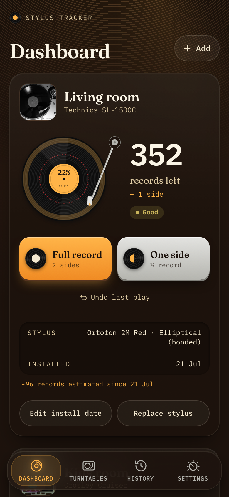
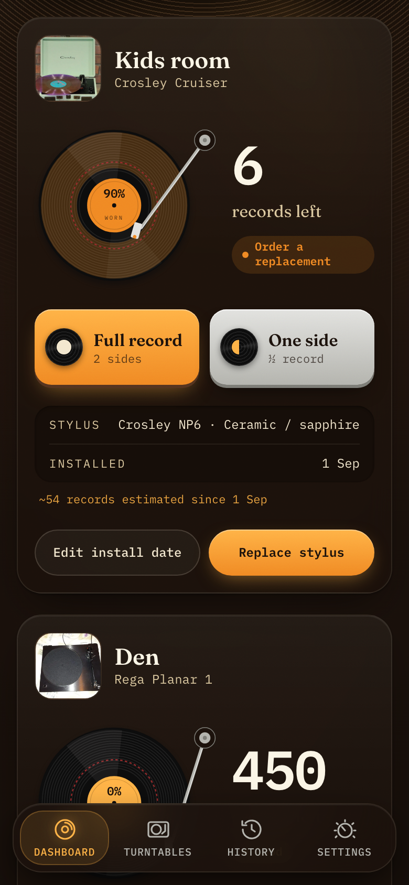
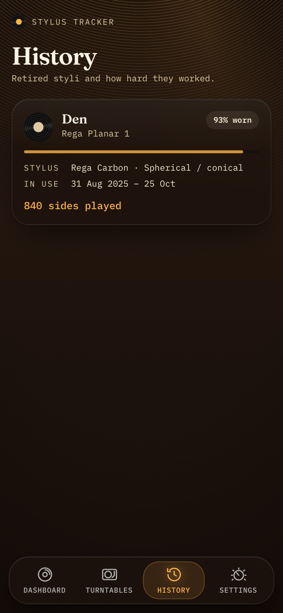
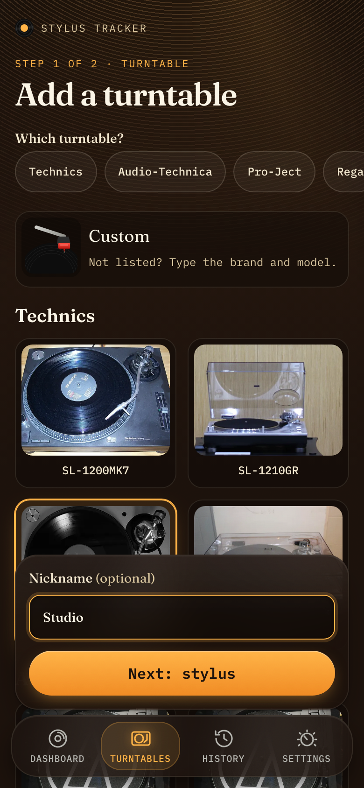
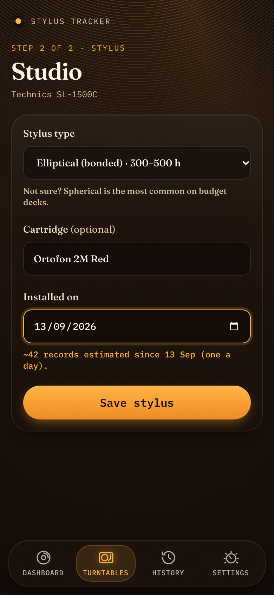
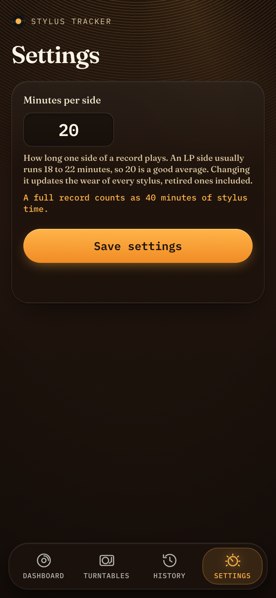

# Stylus Tracker

Self-hosted, mobile-first PWA that tracks turntable stylus wear and tells you how many more
records you can safely play before replacing the stylus.

<p align="center">
  
  
  
</p>

## Features

- **Records left at a glance.** Each turntable shows a vinyl gauge filling up with wear and a
  big count of the records you can still play, plus a status: good, order a replacement, or
  replace now.
- **One-tap logging.** Log a full record or one side; undo the last play if you tapped by
  mistake.
- **Stylus profiles.** Lifespans for ceramic/sapphire, spherical, elliptical, Shibata, line
  contact, MicroLine, or your own number of hours. The app counts against the conservative end
  of each range.
- **Backdated styli.** Add a stylus you installed weeks ago and the app estimates one record a
  day since then, so you don't start from zero.
- **Turntable catalog.** Pick a well-known model (Technics, Audio-Technica, Pro-Ject, Rega,
  and more) to pre-fill the usual cartridge, or add a custom deck.
- **Replace and history.** Replacing a stylus starts a fresh count and keeps the old one in
  history with the sides it played.
- **Works offline.** Installable on Android and iOS. Plays logged without a connection are
  queued on the phone and sent when the server is reachable again.
- **Adjustable side length.** Change the average minutes per side if your collection runs
  longer or shorter than a typical LP.

## Screenshots

| Add a turntable                                                                           | Add a stylus                                                                                                     | Settings                                                                             |
| ----------------------------------------------------------------------------------------- | ---------------------------------------------------------------------------------------------------------------- | ------------------------------------------------------------------------------------ |
|  |  |  |

## How wear is calculated

A side counts as 20 minutes by default (adjustable in Settings) and a full record as two sides.
Used time is compared with the stylus profile's safe limit, for example 300 hours for a bonded
elliptical, which is 450 records. From 75% wear the app suggests ordering a replacement; at
100% it tells you to replace it now.

## Self-host

```sh
docker compose up -d
```

Open http://localhost:3000, or http://<your-computer's-LAN-IP>:3000 from your phone, and install
it to your home screen. Data lives in the `stylus-data` Docker volume. Migrations run
automatically on start.

Optional env: `PORT` (default 3000) and `ORIGIN`. Leave `ORIGIN` unset and the app works on any
address it's reached by, including behind a reverse proxy that sends `X-Forwarded-Proto`
(Caddy and Traefik do by default; for nginx add `proxy_set_header X-Forwarded-Proto $scheme;`
and `proxy_set_header Host $host;`). Set `ORIGIN=https://stylus.example.com` to accept form
submissions only from that one URL.

The app is single-user and has **no built-in login**. Run it on your LAN or behind a reverse
proxy that handles auth (Authelia, Caddy basic auth, Tailscale, and so on).

### Backups

Everything is in one SQLite file, `/data/stylus-tracker.db` inside the container. It runs in WAL
mode, so either stop the container before copying it or use `sqlite3 .backup`.

## Develop

```sh
npm install
cp .env.example .env
npm run dev
npm run test:unit   # TDD watch mode
npm test            # unit + component + e2e
npm run test:docker # builds the image via docker-compose.yml, checks / and boot migrations
```

Browser tests use Playwright's bundled Chromium. If it can't run on your system (e.g. NixOS),
point `CHROMIUM_PATH` at a system Chromium:

```sh
CHROMIUM_PATH=/run/current-system/sw/bin/chromium npm test
```

To refresh the screenshots in `docs/screenshots/`, run `npm run screenshots`. It builds the app,
seeds a throwaway database with demo turntables and captures each page at phone size.

Contributors and coding agents: read [AGENTS.md](AGENTS.md) first. The project is developed TDD-style.

## Stack

SvelteKit and Svelte 5, SQLite with Drizzle ORM, Tailwind CSS 4, a native service worker, and
Vitest plus Playwright for tests. Turntable image credits are in
[static/turntables/CREDITS.md](static/turntables/CREDITS.md).
